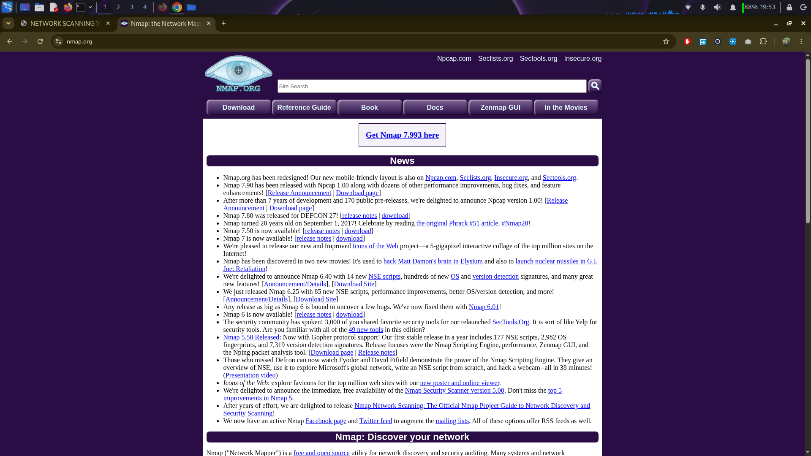
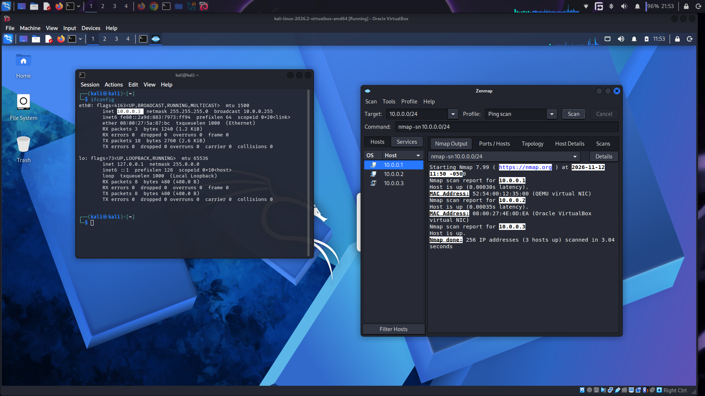
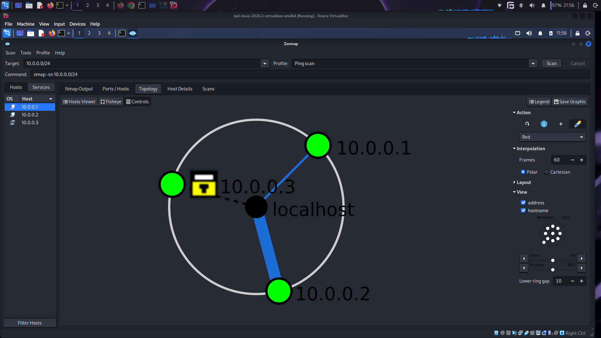
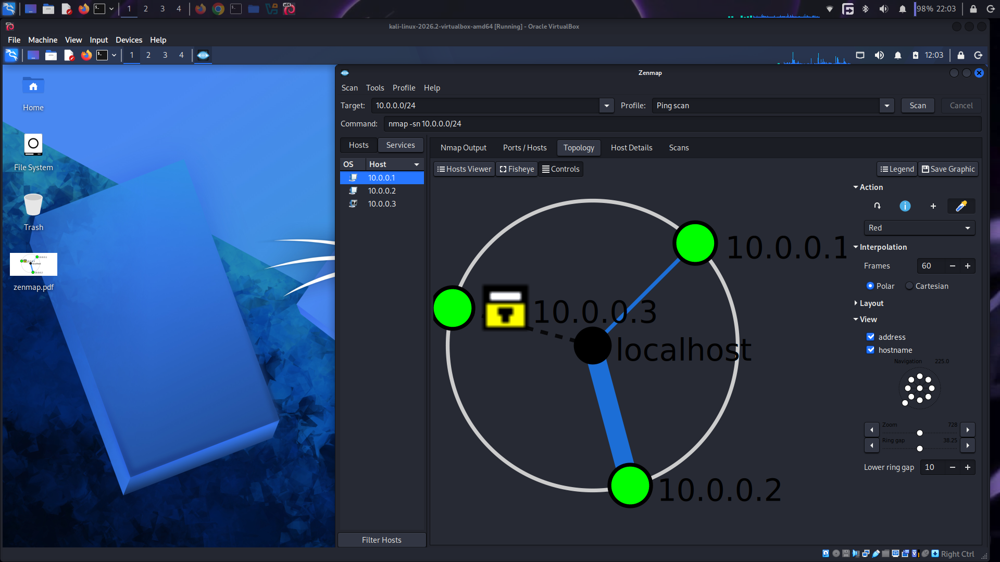

# Zenmap
Zemnap is a GUI base tool use for scanning. It is free and use in operating system such as Windows, Linux or MacOS. It is designed to make network discovery, security auditing, and port scanning easier 

## Installation of zenmap
### Task1 Download & install Zenmap from official website on your Windows PC
1. Open chrome or any browser. search nmap
2. Select the official website of nmap
   
4. Download the nmap according to your system OS
5. install the nmap
6. Linux OS have easy method. Simply open terminal type sudo update and then sudo apt install zenmap 
8.  After installation open the tool
9.  To check your ip type ipconfig on windows and ifconfig on linux

   ### Task2 Find your local IP address & your LAN subnet
   for this type ipconfig on windows and ifconfig on linux\
   ### Task3 Find the list of live hosts/PC’s in your IP subnet
  Copy your ip and insert in the target box. For checking all devices connect on your network type your ip check the last digit to 0/24
    
  ### Task4 How many hosts are live in your subnet?
  #### I my network there three devices are alive including me
  ### Task5 What are the IP addresses of the live hosts?
  #### 10.0.0.1
  #### 10.0.0.2
  #### 10.0.0.3
  ### Task6 What are the MAC addresses of the live hosts?
   #### 52:54:00:12:35:00 
   #### 08:00:27:E4:0D:00
   #### 08:00:27:5A:87:BC
### Task7 Display & save the output topology in PDF Format on your desktop:
 To see topology click on topology

   
12. Download the topology by clicking save Graphic option\
13. select the path\
Save the topology PDF and include it in your final report.\
Now you can check the topology later\
   

 
